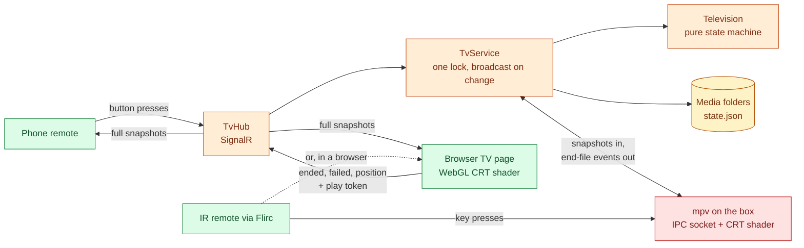

# Rabbit Ears

A 90s TV for the living room: folders of old shows become channels on a curved
CRT picture, driven by a remote. ASP.NET Core (.NET 10), Angular 22, WebGL and mpv.

[](https://github.com/natezimm/rabbit-ears/actions/workflows/ci.yml)
[](LICENSE)
[](https://rabbitears.nathanzimmerman.com)


**[Try the live demo](https://rabbitears.nathanzimmerman.com)**. Every visitor
gets a TV of their own; scan the QR code beside it to use your phone as the
remote. It plays clips cleared for a public site, since real shows cannot be.

## What it does

- Each folder of shows or movies is a **channel**. Flip to one and something is
  already playing; when it ends the next one rolls on an endless shuffle.
- Channels keep **broadcasting while you watch another** (`Live`), or pick up
  where you left them (`Resume`), or start fresh each time (`Random`).
- The picture is bent like a tube TV (bulged glass, rounded corners,
  scanlines), with a chunky green `CH 03` banner and a bars-and-dots volume
  display.
- An IR remote (through a Flirc receiver) and a phone remote drive the same TV
  and can never disagree. No menus, no apps, no accounts.
- On the box, mpv plays the original files in any common format; the browser
  page draws the same picture on a laptop and on the demo site.
- The demo's **VCR** plays a visitor's own videos on extra channels without
  uploading them anywhere.

## Engineering highlights

- **The server is the only source of truth.** `Television` is a pure state
  machine with injected time and randomness, unit tested by single-stepping
  it; clients send presses and render full snapshots
  ([ADR 0001](docs/adr/0001-server-is-the-only-source-of-truth.md),
  [`Television.cs`](src/RabbitEars.Core/Television.cs)).
- **Play tokens and sequence counters** make the screen's reports safe to
  arrive late, twice or out of order, and let any one snapshot rebuild the
  whole display ([ADR 0002](docs/adr/0002-play-tokens-and-sequence-counters.md)).
- **One picture, two renderers.** A WebGL shader in the browser and the same
  tube maths as an mpv hook shader on the box, with mpv driven over its JSON IPC
  socket ([ADR 0003](docs/adr/0003-mpv-on-the-box-browser-as-fallback.md),
  [`MpvScreen.cs`](src/RabbitEars.Api/MpvScreen.cs),
  [`crt-shader.ts`](web/src/app/tv/crt-shader.ts)).
- **No dead frames.** Two `<video>` elements swap so the next episode is loaded
  and seeked before the cut ([`tube.ts`](web/src/app/tv/tube.ts)).
- **A public demo without accounts.** Per-visitor rooms, a shared UTC broadcast
  clock, idle cleanup and per-address rate limits, deliberately not
  authentication ([ADR 0004](docs/adr/0004-demo-rooms-are-not-authentication.md)).
- **Contracts checked by tests.** `ModelSyncTests` fails when the TypeScript
  models drift from the C# records the server sends.

## Architecture



[docs/architecture.md](docs/architecture.md) has the system context, the
button-press sequence with play tokens, demo-mode rooms and the delivery
pipeline. Decisions are recorded in [docs/adr/](docs/adr/).

## Tech stack

| Layer | Technology |
| --- | --- |
| Server | ASP.NET Core minimal APIs and SignalR on .NET 10 |
| Web | Angular 22 (standalone, signals, zoneless), WebGL shader |
| Box screen | mpv over its JSON IPC socket, a GLSL hook shader, ASS overlay text |
| Media | ffprobe for lengths, ffmpeg for test clips and conversion |
| Tests | xUnit, Playwright (desktop and phone), Python `unittest` |
| Delivery | GitHub Actions, Docker, nginx, systemd |

## Run it locally

You need the .NET 10 SDK, Node 22 or newer, and ffmpeg (for the test shows).

```bash
bash scripts/dev.sh
```

Then open <http://localhost:5080/tv> and press `f` for full screen. The first
run generates a few short test "shows" in `dev-media/`. Open
<http://localhost:5080/remote> on your phone (same Wi-Fi, using the laptop's
address) or in another window for the phone remote.

To try it with real shows, point it at a folder that has one subfolder per show:

```bash
Box__MediaRoot="/path/to/shows" bash scripts/dev.sh --no-build
```

To run the public demo's container instead:

```bash
docker build -t rabbit-ears . && docker run --rm -p 8080:8080 rabbit-ears
```

[Using the box](docs/using-the-box.md) covers the remote's keys, how folders
become channels, converting a library for the browser, and settings.

## Tests and quality

Every pull request and every push to `main` runs four CI jobs
([ci.yml](.github/workflows/ci.yml)):

- `backend`: xUnit tests over the state machine, service, scanner, mpv
  driver and model sync (`dotnet test`).
- `web`: Playwright runs the built Angular app against real, isolated API
  processes in Chromium at desktop and phone sizes (`npm run test:browser`, see
  [browser tests](docs/browser-tests.md)).
- `media-preparation`: Python tests for the demo media tooling, with ffmpeg.
- `demo-image`: builds the container, smoke tests it, and verifies the release
  and byte-range media serving.

.NET warnings are errors (`Directory.Build.props`).

## Deployment

**The box.** `bash scripts/deploy.sh YOU@rabbitears.local` builds a
self-contained copy on a laptop (the box needs no .NET or Node), sends it over
and installs it: a systemd service, a kiosk session that opens mpv full screen,
and the screen kept awake. [docs/box-setup.md](docs/box-setup.md) is the full
walk-through. At home it is for the local network only, so do not expose port
5080 to the internet.

**The demo site.** The [`Dockerfile`](Dockerfile) builds the whole app into
one container in demo mode, released by hand on a VM behind nginx with a
rollback point. [demo/README.md](demo/README.md) has the hosting steps, real
content, and the [release checklist](demo/release-checklist.md).

## Project layout

```text
src/RabbitEars.Core/   the TV's behaviour, no web or disk (Television, ShuffleDeck, Tapes)
src/RabbitEars.Api/    the one process: hub, TvService, scanner, admin, mpv driver
  mpv/                 mpv's settings, remote keys and tube shader
web/src/app/           Angular: tv/, remote/, demo/, admin/, core/
tests/                 xUnit tests, and Python tests for the media tooling
deploy/                runs on the box: systemd unit, kiosk launcher, installer
scripts/               runs on a laptop: dev, publish, deploy, media tools
demo/                  hosting the public demo
docs/                  architecture, ADRs, guides; docs/archive/ for finished plans
```

## Roadmap

- An editor for global picture, volume and system settings. Channel names,
  numbering, eligibility and per-channel tune-in modes are already editable at
  `/admin` ([channel administration](docs/channel-administration.md)).
- HDMI-CEC, so the TV's own remote can drive it.
- A first install on the real mini PC. The install scripts have been rehearsed
  on a laptop; expect to adjust them on first contact with the hardware.

## License

MIT. Credits and licenses for third-party material are in
[THIRD-PARTY-NOTICES.md](THIRD-PARTY-NOTICES.md).

## Run on a Mac

The [Mac desktop setup](docs/mac-setup.md) builds a self-contained API and launcher
that run mpv as your user. Start and quit the TV without Docker or a system service.
Apple silicon is the initial target; see the setup guide for dependencies, phone
remote access, saved state and the manual validation checklist.
