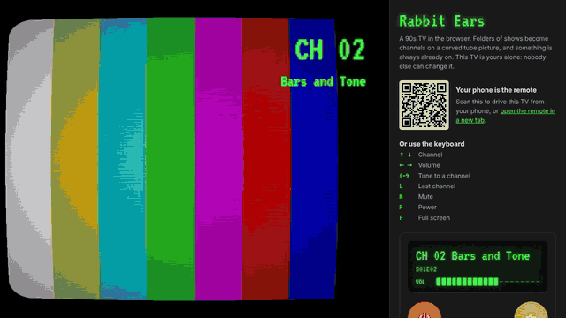

# Rabbit Ears

A 90s TV for the living room, built with Angular and ASP.NET Core.

Folders of old shows and movies become **channels**. Flip to one and something
is already playing; when it ends the next one rolls on an endless shuffle.
The picture is bent like a tube TV (bulged glass, rounded corners, scanlines),
with a chunky green `CH 03` banner and a bars-and-dots volume display. No menus,
no apps: just a remote and channels.

It runs on a mini PC under Linux: one small service that owns the TV, and mpv
playing the shows full screen, exactly as they were downloaded. On a laptop and
on the demo site, a browser page draws the same picture instead.

There is a public demo site where every visitor gets a TV of their own; scan
the QR code beside it to use your phone as the remote. It plays clips made for
it, since real shows cannot be put on a public website.



## Run it on your laptop

You need the .NET 10 SDK, Node 22 or newer, and ffmpeg (for the test shows).

```bash
bash scripts/dev.sh
```

Then open <http://localhost:5080/tv> and press `f` for full screen. The first
run generates a few short test "shows" in `dev-media/`. Open
<http://localhost:5080/remote> on your phone (same Wi-Fi, using the laptop's
address) or in another window for the phone remote.

To try it with real shows, point it at a folder that has one subfolder per show:

```bash
Box__MediaRoot="/path/to/shows" bash scripts/dev.sh --no-build
```

Run the tests with:

```bash
dotnet test
```

Run the desktop/phone browser regression suite with `(cd web && npm run test:browser)`
after installing Chromium. [Browser test instructions](docs/browser-tests.md)
cover setup, individual runs, and the CI report/traces.

## The remote

The TV page takes plain key presses, which is what a Flirc USB receiver sends.
Program the Flirc with its **Full Keyboard** profile:

| Key | Remote button | What it does |
| --- | --- | --- |
| Up / Down | Channel up / down | Next / previous channel, wrapping around |
| Right / Left | Volume up / down | One step per press; held buttons do not repeat |
| `m` | Mute | Mute |
| `p` | Power | Standby (the picture collapses to a line, like a tube switching off) |
| `0`–`9` | Number keys | Tune straight to a channel; Enter/OK skips the short wait |
| `i` | Info | Flash the channel banner |
| `l` | Last | Jump back to the previous channel |

Volume-down once more at 0 says `GOODBYE` and shuts the box down cleanly when
`PowerOffAtZeroVolume` is on (it is in the mini PC config), so it is safe to pull
the plug.

The phone remote at `/remote` has the same buttons plus a channel list. It and
the TV both just draw what the box says is on, so they cannot disagree.

At home, choose **Manage channels** on the remote or open `/admin` to rename,
number, hide, and filter channels and set each channel's tune-in behavior.
See [channel administration](docs/channel-administration.md). Metadata is saved
separately from media folders; renaming a display label preserves playback.

## Shows and movies

One folder per channel; the folder name is the channel name. Season subfolders
are fine. Channels are numbered from 2 in A-to-Z order.

```text
/srv/rabbitears/media/
  Arthur/                 -> CH 02  Arthur
    Season 1/S01E01.mp4
  Disney Movies/          -> CH 03  Disney Movies
    The Lion King.mp4
    Aladdin.mp4
  Dragon Tales/           -> CH 04  Dragon Tales
    S01E01.mp4
```

A folder of movies is a channel like any other: each film takes its turn in the
shuffle. With the default `Live` setting every channel keeps broadcasting while
you watch another one, like real TV: flip away for five minutes and the show is
five minutes further on when you come back, or onto its next episode. `Resume`
instead picks up exactly where you left it, which some prefer for films.

On the box, mpv plays the files as they are: MKV, AVI, MP4, MPEG and the other
common rip formats, with no converting. The browser TV page (the laptop and the
demo site) only plays H.264 + AAC in MP4, or WebM, and `GET /api/library` lists
any files it cannot play. To make a library the browser can play too, convert
it once, keeping its folder layout:

```bash
bash scripts/convert-media.sh /path/to/originals /path/to/converted
```

New episodes and new show folders are picked up within ten minutes, or at once
with `curl -X POST http://localhost:5080/api/rescan`.

## Settings

Everything is in the `Box` section of
[`src/RabbitEars.Api/appsettings.json`](src/RabbitEars.Api/appsettings.json).
On the mini PC, override settings in `/etc/rabbitears/box.env` instead (names
joined with two underscores) and restart the service. The ones worth knowing:

| Setting | Default | |
| --- | --- | --- |
| `Tv.TuneIn` | `Live` | `Live`: channels keep running while you are away, rolling into later episodes. `Resume`: a channel picks up exactly where you left it. `Random`: every flip starts a fresh shuffled episode. |
| `Tv.StartOffsetMin` / `Max` | `6` / `10` | A new episode starts this many seconds in, so it feels already on. |
| `Picture.Transition` | `none` | Channel-change effect: `none`, `static` (analog snow) or `glitch`. |
| `Picture.Crt.*` | see the file | `Curvature`, `CornerRadius`, `Vignette`, `ScanlineIntensity`. `Enabled: false` shows the plain video with no shader at all, the lightest option for a weak graphics chip. |
| `Picture.Osd.Color` | `#3DFF6E` | The phosphor green. |
| `Tv.InitialVolume` / `VolumeStep` | `60` / `5` | |
| `Ffprobe` | `ffprobe` | Reads each episode's length from its file header so `Live` channels know when to roll to the next episode. Without it, lengths are learned as episodes play. |
| `Player.Kind` | `mpv` | What draws the box's screen: `mpv` plays any format, `browser` is the `/tv` page in Chromium (MP4 and WebM only). Takes effect at the next login. |

## Put it on the mini PC

Written for Ubuntu Desktop; the box it is meant for runs Ubuntu 26 on an Intel
mini PC. The full walk-through, with what to expect at each step and what to do
when something is off, is [docs/box-setup.md](docs/box-setup.md). In short:

1. On the box, turn on remote login:

   ```bash
   sudo apt update && sudo apt install -y openssh-server
   ```

2. On your laptop, build a self-contained copy (the box needs no .NET or Node),
   send it over and install it. Re-running this is also how you update:

   ```bash
   bash scripts/deploy.sh YOU@rabbitears.local
   ```

   The installer starts the service on boot, opens the TV full screen at login,
   installs mpv and ffmpeg (and Chromium, if there is no browser), and stops the screen
   blanking or locking. Anything it could not do itself is listed at the end.
3. On the box, turn on **Settings > System > Users > Automatic Login**, set the
   display to 1080p, and pick the TV as the sound output.
4. Copy shows into `/srv/rabbitears/media/` and reboot.

The install scripts have been rehearsed on the laptop but **not yet run on the
real box**; expect to adjust them on first contact with the hardware.

## The demo site

The [`Dockerfile`](Dockerfile) builds the whole thing into one container in
demo mode (`Box:Demo:Enabled`): every browser picks its own room id, so each
visitor gets a separate TV that nobody else can change. Nothing is saved, idle
TVs switch off after 15 minutes, and the clips are generated at build time by
`scripts/make-dev-media.sh`. `/` opens `/demo`, which puts the TV, a remote and
a QR code for a phone remote on one page.

```bash
docker build -t rabbit-ears . && docker run --rm -p 8080:8080 rabbit-ears
```

[demo/README.md](demo/README.md) has the steps for hosting it on a server
behind nginx.

The shared-VM Compose configuration uses localhost port **8620**. To replace
generated clips with cleared real content, follow [the media preparation and
mount guide](demo/real-media.md). The [plan](docs/channel-and-demo-plan.md)
records both this workflow and the home channel editor.

## How it fits together

```text
src/RabbitEars.Core/     no web or disk: the TV's behaviour, unit tested
  Television.cs            the state machine (channels, volume, standby, digits)
  ShuffleDeck.cs           every episode once per pass, no back-to-back repeats
src/RabbitEars.Api/      ASP.NET Core: one process that owns the TV
  TvService.cs             the single television; saves state, rescans, broadcasts
  TvHub.cs                 SignalR: button presses in, state out
  LibraryScanner.cs        folders -> channels
  EpisodeProbe.cs          asks ffprobe how long each episode is
  MpvScreen.cs             the box's screen: drives mpv as tube.ts drives <video>
  MpvPlayer.cs             keeps mpv connected and feeds MpvScreen one thing at a time
  MpvOsd.cs                the green on-screen display, drawn as mpv overlay text
  mpv/                     mpv's settings, remote keys and tube shader
web/src/app/
  tv/crt-shader.ts         the tube picture (a WebGL shader)
  tv/tube.ts               two video players, so channel changes cut cleanly
  tv/tv-screen.*           the TV page and green on-screen display
  remote/                  the phone remote
  demo/                    the public demo page: TV, remote and QR code together
deploy/                    systemd service, kiosk launcher, installer (run on the box)
scripts/                   build, deploy to the box, convert shows (run on the laptop)
docs/box-setup.md          step-by-step checklist for getting the box working
Dockerfile, demo/          the public demo site and how to host it
```

The box is the single source of truth. The TV page and the phone only send
button presses and render the state that comes back over SignalR. There are no
accounts or pairing: it is meant for your home network only, so do not expose
port 5080 to the internet. The demo site's container is the one build meant to
be public.

## Not built yet

- An editor for global picture, volume, and system settings. Channel names,
  numbering, eligibility and per-channel tune-in modes are already editable at `/admin`.
- HDMI-CEC, so the TV's own remote can drive it.

## License

MIT. Credits and licenses for third-party material are in
[THIRD-PARTY-NOTICES.md](THIRD-PARTY-NOTICES.md).
