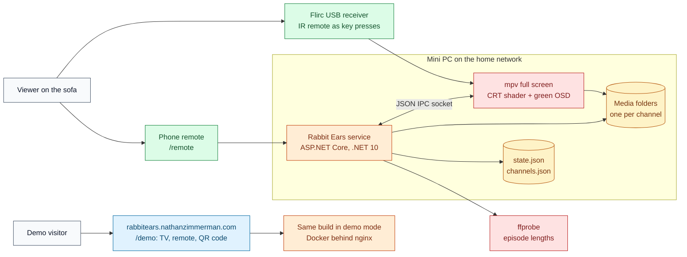
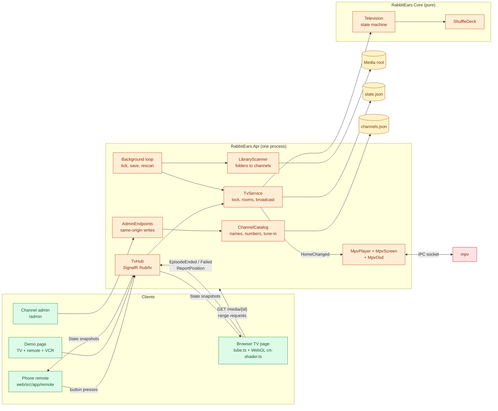
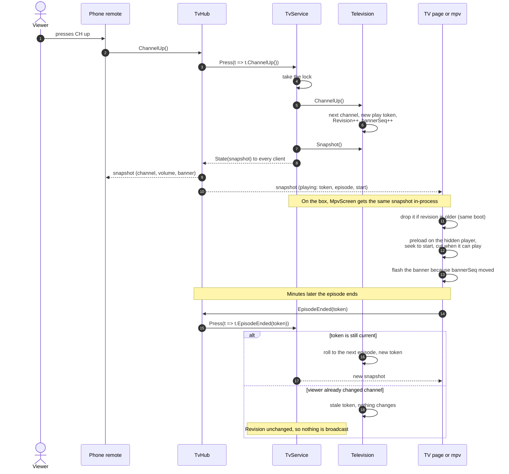
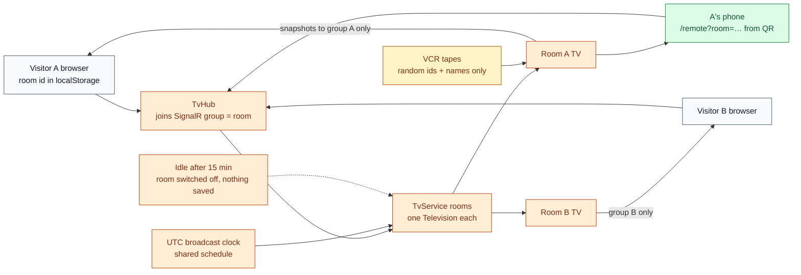
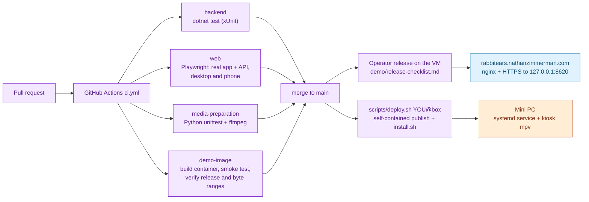

# Architecture

Rabbit Ears is one ASP.NET Core process that owns a television, and a handful
of screens that draw it. The server holds the only copy of the TV's state;
everything else sends button presses and renders what comes back. The
decisions behind that shape are recorded in [docs/adr/](adr/).

All diagrams use the same colour key as the other repositories in this
portfolio: people are grey, clients green, server processes orange, stored
data amber, delivery purple and outside programs red.

## System context

At home, the box is a Linux mini PC plugged into a TV. On the public demo the
same build runs in a container behind nginx, and a browser page plays the role
of the box's screen.

## Containers and runtime

Inside the process, `Television` is a pure state machine with no disk, web or
threads; time and randomness are injected so tests can single-step it.
`TvService` wraps it with a lock, a background loop and SignalR. Either mpv
(on the box) or the Angular `/tv` page (laptop and demo) draws the picture.

## Signature flow: a button press becomes a picture

This is the path every remote button takes, and the reason the TV and the
phone can never disagree. Play tokens make late reports harmless.

The details that make this work:

- **One lock, one writer.** `TvService.Press` applies the command under a lock
  and broadcasts only when `Television.Revision` changed, so a no-op press
  costs nothing on the wire.
- **Play tokens.** Every "play this" instruction carries a unique token that
  the screen echoes in `EpisodeEnded`, `EpisodeFailed` and `ReportPosition`.
  A stale "ended" cannot skip an episode on a channel the viewer has left,
  while a stale position report still lands, which is how `Resume` works.
  On the box, mpv's playlist entry ids play the same part.
- **Sequence counters.** `bannerSeq`, `volumeSeq` and `message.seq` tick when
  that piece of the on-screen display should flash. Clients compare numbers;
  there are no separate "show the banner" events to lose.
- **Snapshot ordering.** Snapshots carry `boot` and `revision`;
  `web/src/app/core/tv-link.ts` drops an older revision from the same boot,
  and a new boot id resets the counter after a restart.
- **No dead frames.** `tube.ts` keeps two `<video>` elements: the hidden one
  loads the next episode muted and seeks to its start point, and the cut
  happens only once it can play.

## Demo mode: one TV per visitor

With `Box:Demo:Enabled`, `TvService` runs a `Television` per room instead of
one for the house. A room id is made up by the browser, so this isolates
visitors without being authentication (see
[ADR 0004](adr/0004-demo-rooms-are-not-authentication.md)).

The demo page's VCR (`core/tape-deck.ts`) plays a visitor's own files from
blob URLs. The hub receives only random ids and names, `Tapes.cs` turns them
into extra channels for that room, and the files never leave the visitor's
browser. Channels with known lengths follow a repeating, UTC-anchored
playlist, so everyone tuned to a channel sees the same programme while channel,
volume and power stay per room.

## Delivery

Both releases are deliberate, manual steps. The demo is released by an operator
following [the release checklist](../demo/release-checklist.md), which keeps a
rollback point; the box is updated from a laptop with `scripts/deploy.sh`.

## Source boundaries

| Path | Owns |
| --- | --- |
| `src/RabbitEars.Core/` | TV behaviour with no I/O: `Television`, `ShuffleDeck`, `Tapes`, the snapshot records in `Models.cs` |
| `src/RabbitEars.Api/` | The process: hub, `TvService`, scanning, probing, channel catalog, admin endpoints, rate limiting, mpv driver |
| `src/RabbitEars.Api/mpv/` | mpv's config, remote keys and `crt.glsl`, the tube maths as an mpv hook shader |
| `web/src/app/` | Angular 22 app: `tv/`, `remote/`, `demo/`, `admin/`, and `core/` for the SignalR link and models |
| `tests/` | xUnit tests for Core and Api, and Python tests for the media tooling |
| `deploy/` | Runs on the box: systemd unit, kiosk launcher, installer |
| `scripts/` | Runs on a laptop: dev server, publish, deploy, media conversion and demo-media tooling |
| `demo/` | Hosting the public demo: compose files, nginx, release checklist |

`web/src/app/core/models.ts` mirrors `Models.cs` and the picture options by
hand; `ModelSyncTests` fails when they drift. `MpvOsd.cs` and `tv-screen.css`
lay out the green display on the same 4:3 frame and are kept in step the same
way.

## Public-demo resource boundaries

Local tape preflight reads metadata sequentially with cancellation; only IDs and
names cross SignalR. `LoadTapes` returns acceptance, allowing `TapeDeck` to keep
previous URLs until replacement succeeds. `tape-policy.ts` holds browser limits;
a backend contract test checks file/channel limits against `Tapes`.

`TvService.Join` admits demo rooms and connections under its existing lock.
Room creation has a bounded expiring address budget, and replacement has a room
budget. Direct `/media` requests have independent concurrency limits and a
shared read pacer (`DemoMediaBudget`), preserving standard single-range seeking.
The global HTTP/hub budget, bounded address partitions, and container caps limit
other work. See [operator limits and rollout checks](../demo/protection.md).
